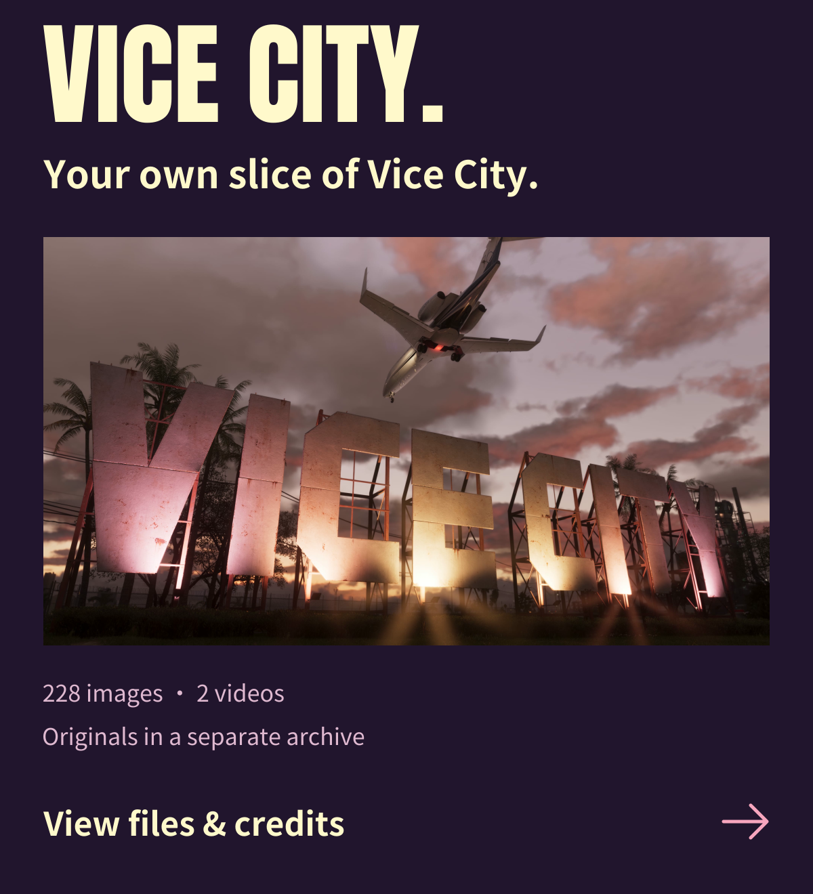
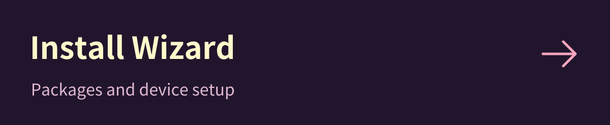
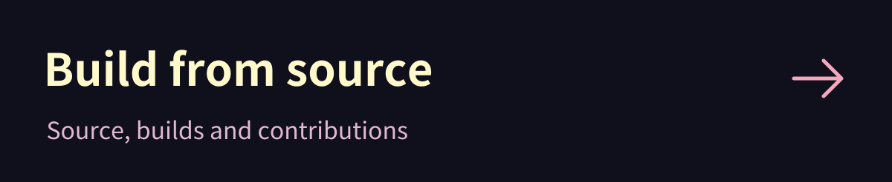
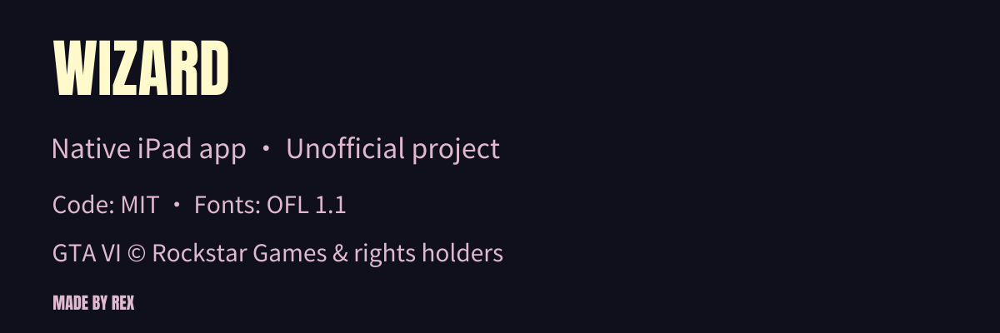

<a href="README.md">简体中文</a> · <a href="README.zh-TW.md">繁體中文</a> · <strong>English</strong> · <a href="README.ja.md">日本語</a>

<a href="docs/en/INSTALL.md"><picture><source media="(max-width: 767px)" srcset="assets/readme/hero-en-mobile.svg"></picture></a>
<picture><source media="(max-width: 767px)" srcset="assets/readme/showcase-en-mobile.svg"></picture>
<a href="docs/en/GTA6-MATERIALS.md"><picture><source media="(max-width: 767px)" srcset="assets/readme/collection-en-mobile.svg"></picture></a>
<a href="docs/en/INSTALL.md"><picture><source media="(max-width: 767px)" srcset="assets/readme/install-en-mobile.svg"></picture></a>
<a href="docs/en/AGENT-INSTALL.md"><picture><source media="(max-width: 767px)" srcset="assets/readme/agent-en-mobile.svg"></picture></a>
<a href="docs/open-source/README.md"><picture><source media="(max-width: 767px)" srcset="assets/readme/source-en-mobile.svg"></picture></a>
<a href="THIRD_PARTY.md"><picture><source media="(max-width: 767px)" srcset="assets/readme/footer-en-mobile.svg"></picture></a>

