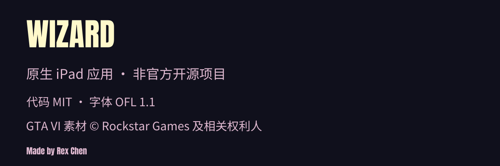

<strong>简体中文</strong> · <a href="README.zh-TW.md">繁體中文</a> · <a href="README.en.md">English</a> · <a href="README.ja.md">日本語</a>

<a href="docs/INSTALL.md"><picture><source media="(max-width: 767px)" srcset="assets/readme/hero-mobile.svg"></picture></a>
<picture><source media="(max-width: 767px)" srcset="assets/readme/showcase-mobile.svg"></picture>

<a href="docs/open-source/GTA6-MATERIALS.md"><picture><source media="(max-width: 767px)" srcset="assets/readme/collection-mobile.svg"></picture></a>
<a href="docs/INSTALL.md"><picture><source media="(max-width: 767px)" srcset="assets/readme/install-mobile.svg"></picture></a>
<a href="docs/AGENT-INSTALL.md"><picture><source media="(max-width: 767px)" srcset="assets/readme/agent-mobile.svg"></picture></a>
<a href="docs/zh-CN/DEVELOPMENT.md"><picture><source media="(max-width: 767px)" srcset="assets/readme/source-mobile.svg"></picture></a>
<a href="docs/zh-CN/THIRD_PARTY.md"><picture><source media="(max-width: 767px)" srcset="assets/readme/footer-mobile.svg"></picture></a>

