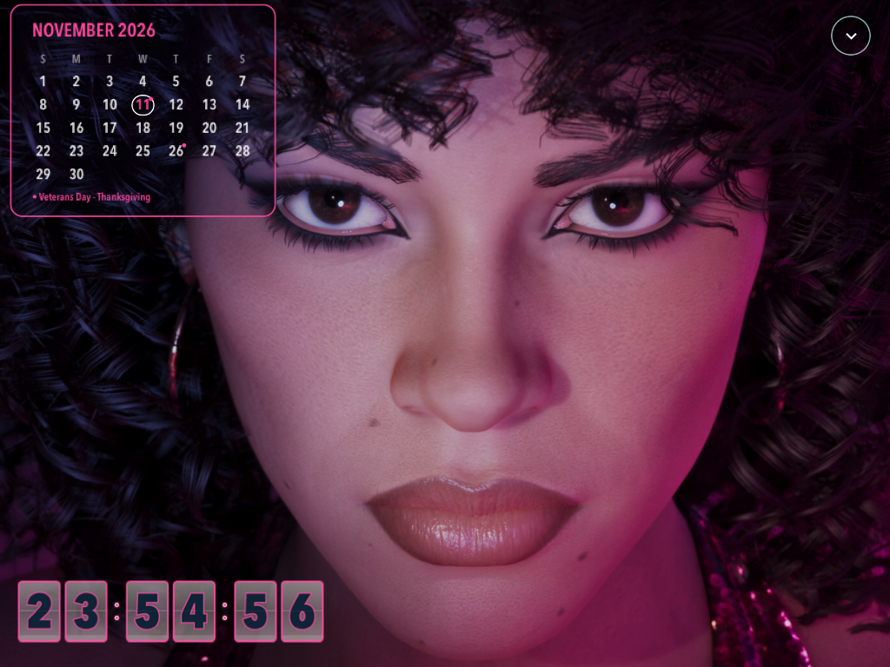
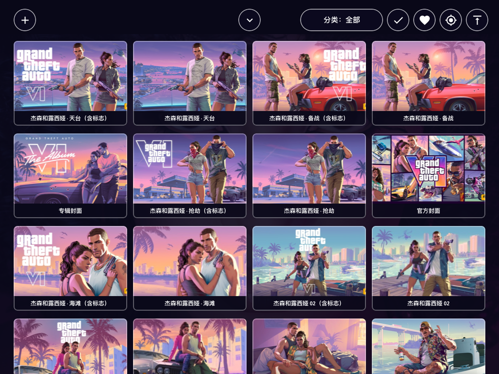

<p align="center">
<picture>
  <source media="(max-width: 767px) and (prefers-color-scheme: dark)" srcset="assets/readme/hero-mobile-dark.svg">
  <source media="(max-width: 767px)" srcset="assets/readme/hero-mobile.svg">
  <source media="(prefers-color-scheme: dark)" srcset="assets/readme/hero-dark.svg">
  
</picture>
</p>

<p align="center">
<a href="https://github.com/rexchen1803/wizard/releases/tag/v0.2.0-preview.1">安装包</a> ·
<a href="docs/AGENT-INSTALL.md">Agent 安装</a> ·
<a href="docs/INSTALL.md">安装指南</a> ·
<a href="docs/COMPATIBILITY.md">兼容性</a>
</p>

**Wizard 是为旧款 iPad 编写的原生展示应用。** 放在书桌、床头或工作台，让一块闲置的屏幕继续显示时间、照片和喜欢的影像。使用 Objective-C / UIKit，提供 `armv7 + arm64` 通用构建，面向已越狱的 rootful iPad 和 iOS 9–12。

## 看一眼 Wizard

<p align="center"></p>

<table>
<tr>
<td width="50%"></td>
<td width="50%"></td>
</tr>
<tr><td align="center">把喜欢的画面，留在屏幕上</td><td align="center">按内容分类，找到下一张壁纸</td></tr>
</table>

演示来自 iPad 2 / iOS 9.3.5 上运行的 source36 原生截图。[截图来源与版本](assets/demo/README.md) · [当前预览版的支持范围](docs/COMPATIBILITY.md)。

## 可以做什么

- **时钟与日历**：翻页数字、秒显示、12/24 小时、四种日期语言；时钟、日期、日历均可调整位置和大小。
- **壁纸图库**：分类、收藏、系统照片导入、画面裁切、切换效果，以及独立的壁纸布局。
- **视频展示**：本地播放、暂停、进度、音量、最小化与返回；投屏及家庭状态接入见[兼容性说明](docs/COMPATIBILITY.md)。
- **GTA VI 素材**：提供适合 App 使用的 **228 张图片 + 2 段预告片**，另附 **343 张原始图片、2 段原始视频与 2 份字幕**。素材版权归 Rockstar Games 及相应权利人，见[素材与署名](assets/media/ATTRIBUTION.md)。

## 选择一种安装方式

| 方式 | 适合谁 | 入口 |
| --- | --- | --- |
| **直接安装 `.deb`** | 已有受支持 rootful 越狱环境，想快速安装 | [下载安装包](https://github.com/rexchen1803/wizard/releases/download/v0.2.0-preview.1/wizard_0.2.0-20261111.37_iphoneos-arm.deb) · [安装步骤](docs/INSTALL.md) |
| **交给 Agent** | 让 Codex、Claude Code 等协助核对环境、备份和安装 | [复制安装提示词](docs/AGENT-INSTALL.md) |
| **从源码构建** | 想阅读、修改或自行打包 | [构建说明](docs/open-source/README.md) · [参与开发](CONTRIBUTING.md) |

这是 **0.2.0 预览版**。安装包结构与安装预检已在本机夹具中测试；首次安装、该构建的实际显示与物理操作仍待设备验证。原版未越狱 iOS、普通侧载和较新系统不属于已验证路径。具体机型、已检查范围和限制请先看[兼容性表](docs/COMPATIBILITY.md)。

### 下载 GTA VI 素材

| 素材包 | 内容 | 下载 |
| --- | --- | --- |
| **App 图库包** | 230 项目录、228 张图片、2 段兼容视频及缩略图 | [wizard-gta6-gallery-20261112.zip](https://github.com/rexchen1803/wizard/releases/download/v0.2.0-preview.1/wizard-gta6-gallery-20261112.zip) |
| **原始素材包** | 343 张原图、2 段 MKV 与 2 份 SRT | [gta6-original-materials-20261112.zip](https://github.com/rexchen1803/wizard/releases/download/v0.2.0-preview.1/gta6-original-materials-20261112.zip) |

素材包随 GitHub Release 提供，校验值见 [MANIFEST.json](assets/media/MANIFEST.json)。合并图库时保留原有的 `assets/user` 和设置；[安装指南](docs/INSTALL.md)说明了目录位置、备份和导入方法。

## 从源码开始

在装有 Apple 开发工具的 Mac 上，自行准备 iPhoneOS SDK：

```sh
git clone https://github.com/rexchen1803/wizard.git
cd wizard
IOS_SDK="/path/to/iPhoneOS9.3.sdk" ./scripts/build-ipad.sh --out build
python3 tests/native-regressions.py
```

SDK 不随项目分发。当前验证 SDK 为 iPhoneOS 9.3；构建生成未签名的通用 App。[完整构建与回归命令](docs/open-source/README.md)。

## 项目地图

| 目录 | 内容 |
| --- | --- |
| [`App/`](App/) | 原生 App、图标和可选电源插件源码 |
| [`scripts/`](scripts/) | 构建、打包及仓库检查工具 |
| [`tests/`](tests/)、[`App/tests/`](App/tests/) | 主机回归与打包检查 |
| [`docs/`](docs/) | 安装、Agent 提示词、兼容性与技术说明 |
| [`assets/`](assets/) | README 视觉、原生演示与 Release 素材清单 |

[更新记录](CHANGELOG.md) · [参与贡献](CONTRIBUTING.md) · [报告问题](https://github.com/rexchen1803/wizard/issues/new/choose) · [安全问题](SECURITY.md)

## 许可与署名

Wizard 自有源码采用 [MIT License](LICENSE)。Google Material 图标路径遵循 [Apache 2.0](licenses/Material-Icons-Apache-2.0.txt)，署名见 [NOTICE](NOTICE)。GTA VI 图片、视频、缩略图及衍生素材版权属于 **Rockstar Games 及相应权利人**，适用独立的权利声明；[第三方材料说明](THIRD_PARTY.md)列明各自范围。本项目与 Rockstar Games 无隶属或赞助关系。

<p align="center">Made by <a href="https://github.com/rexchen1803">Rex</a> · <a href="https://rexchen.si">rexchen.si</a></p>
