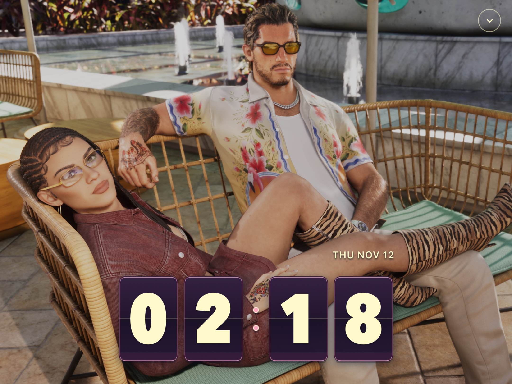
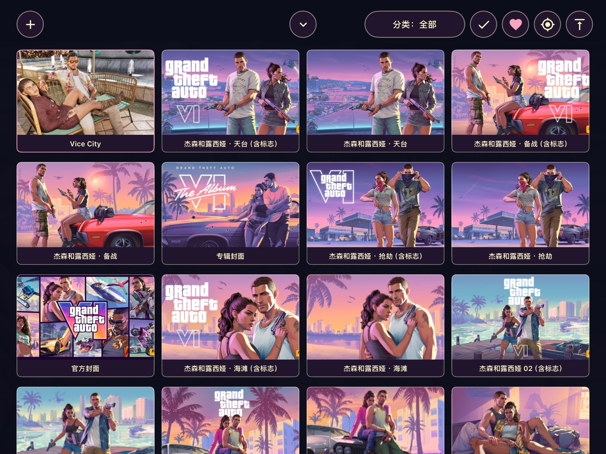
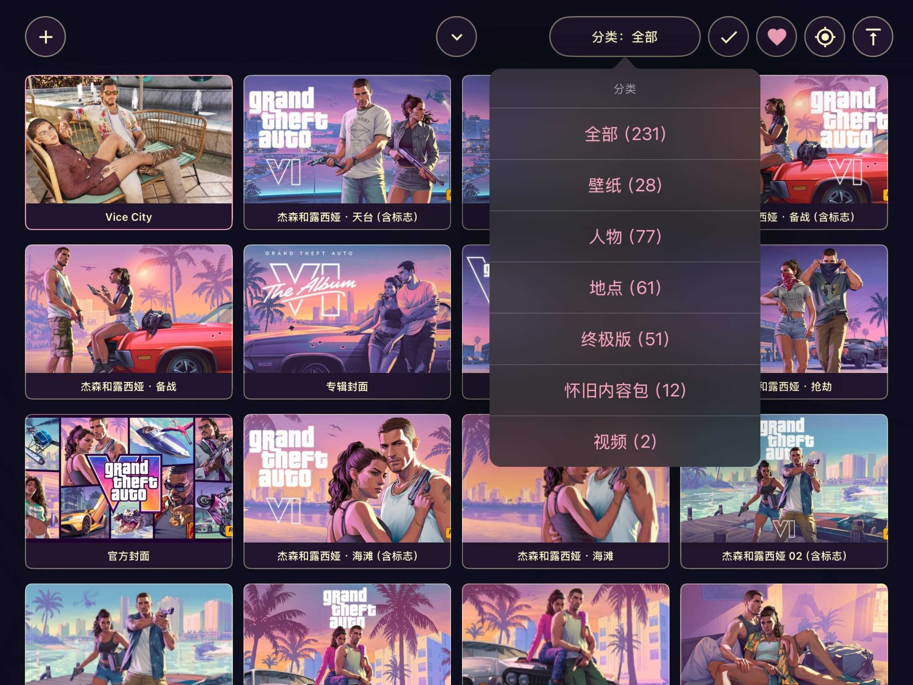
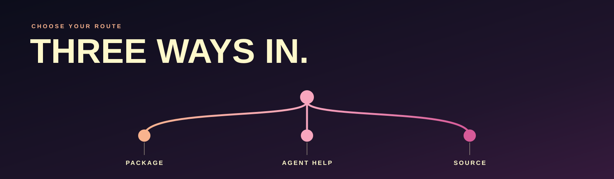
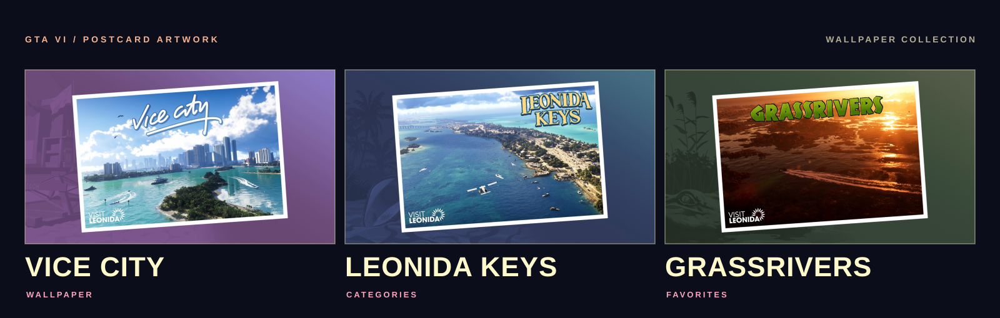
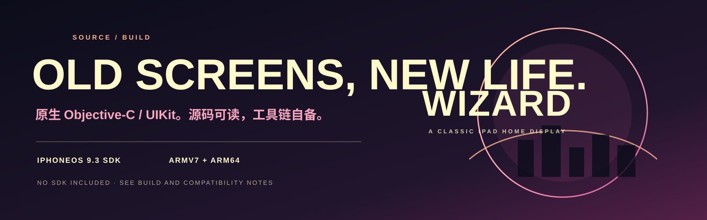

<p align="center">
<picture>
  <source media="(max-width: 767px) and (prefers-color-scheme: dark)" srcset="assets/readme/hero-mobile-dark.svg">
  <source media="(max-width: 767px)" srcset="assets/readme/hero-mobile.svg">
  <source media="(prefers-color-scheme: dark)" srcset="assets/readme/hero-dark.svg">
  
</picture>
</p>

<p align="center">
  <a href="https://github.com/rexchen1803/wizard/releases/tag/v0.2.0-preview.2"><strong>下载预览版</strong></a> &nbsp;·&nbsp;
  <a href="docs/AGENT-INSTALL.md">Agent 安装</a> &nbsp;·&nbsp;
  <a href="docs/INSTALL.md">安装指南</a> &nbsp;·&nbsp;
  <a href="docs/COMPATIBILITY.md">兼容性</a>
</p>

<p align="center"><strong>翻页时钟 · 壁纸图库 · 本地影像</strong></p>

## 时钟与画面

翻页时钟与日历浮在你选的壁纸上。Wizard 是为旧款 iPad 编写的原生 Objective-C / UIKit 展示应用，适合放在书桌、床头或工作台，让闲置的屏幕继续显示时间、照片和喜欢的影像。

<p align="center"><a href="assets/demo/home-miami.jpg"></a></p>
<p align="right"><sub>主屏 · iPad 模拟器 / iOS 18.0 · build 20261112.38</sub></p>

<table>
<tr>
<td width="50%"><a href="assets/demo/gallery-miami.jpg"></a><p align="center"><strong>壁纸图库</strong><br>分类、收藏，挑选下一张画面。</p></td>
<td width="50%"><a href="assets/demo/categories-miami.jpg"></a><p align="center"><strong>内容分类</strong><br>按壁纸、人物、地点和视频浏览。</p></td>
</tr>
</table>

演示来自 **iPad 模拟器 / iOS 18.0 · build 20261112.38**，与设备构建绑定同一份源码和资源。[截图来源与保留的旧版实机图](assets/demo/README.md) · [支持范围](docs/COMPATIBILITY.md)。

<details>
<summary>菜单、主题与布局编辑</summary>

<p><a href="assets/demo/menu-miami.jpg">主菜单</a> · <a href="assets/demo/settings-miami.jpg">设置</a> · <a href="assets/demo/themes-miami.jpg">主题</a> · <a href="assets/demo/clock-edit-miami.jpg">时钟编辑</a> · <a href="assets/demo/calendar-miami.jpg">日历</a></p>

</details>

## 把 iPad 留给你喜欢的画面

| 时钟与日历 | 壁纸图库 | 本地视频 |
| --- | --- | --- |
| 翻页数字、秒显示、12/24 小时、四种日期语言。时钟、日期和日历都能单独调整位置与大小。 | 分类、收藏、系统照片导入、画面裁切、切换效果，以及独立壁纸布局。 | 播放、暂停、进度、音量、最小化和返回。投屏及家庭状态接入请看[兼容性说明](docs/COMPATIBILITY.md)。 |

## 安装预览版

<p align="center"></p>

| 直接安装 | 交给 Agent | 源码构建 |
| --- | --- | --- |
| 已有受支持的 rootful 越狱环境，想快速安装 `.deb`。<br><br>[下载 0.2.0 预览安装包](https://github.com/rexchen1803/wizard/releases/download/v0.2.0-preview.2/wizard_0.2.0-20261112.38_iphoneos-arm.deb)<br>[安装步骤](docs/INSTALL.md) | 让 Codex 或 Claude Code 协助核对环境、备份和安装。<br><br>[查看一次性安装提示词](docs/AGENT-INSTALL.md) | 想阅读、修改或自行打包。<br><br>[构建说明](docs/open-source/README.md)<br>[参与开发](CONTRIBUTING.md) |

**支持边界：** 已验证路径仅限兼容性表中列出的设备和准备状态。Stock iOS、普通侧载、首次安装与较新系统并非已验证路径；构建成功不等于设备运行验收。

> **0.2.0 预览版 · build 20261112.38** — 此 build 已完成本机构建与模拟器界面检查；实体 iPad 安装和实际操作仍待验证。目标设备和准备条件见[兼容性范围](docs/COMPATIBILITY.md)。

## Vice City 素材

<p align="center"></p>

图库支持按类别浏览、收藏画面并设为壁纸，也可导入系统照片。

随 App 图库使用的 GTA VI 素材与独立原始资料均通过 GitHub Release 提供。Rockstar Games 及相应权利人保留素材权利；素材包的单独许可说明见[素材与署名](assets/media/ATTRIBUTION.md)。

| 素材包 | 内容 | 获取 |
| --- | --- | --- |
| **App 图库包** | 230 项目录、228 张图片、2 段兼容视频及缩略图 | [下载 `wizard-gta6-gallery-20261112.zip`](https://github.com/rexchen1803/wizard/releases/download/v0.2.0-preview.2/wizard-gta6-gallery-20261112.zip) |
| **原始素材包** | 343 张原图、2 段 MKV 与 2 份 SRT | [下载 `gta6-original-materials-20261112.zip`](https://github.com/rexchen1803/wizard/releases/download/v0.2.0-preview.2/gta6-original-materials-20261112.zip) |

校验值见 [MANIFEST.json](assets/media/MANIFEST.json)。合并图库时保留原有的 `assets/user` 和设置；[安装指南](docs/INSTALL.md)说明目录位置、备份和导入方法。

## 从源码构建

<p align="center"></p>

在装有 Apple 开发工具的 Mac 上，自行准备 iPhoneOS SDK：

```sh
git clone https://github.com/rexchen1803/wizard.git
cd wizard
IOS_SDK="/path/to/iPhoneOS9.3.sdk" ./scripts/build-ipad.sh --out build
python3 tests/native-regressions.py
```

SDK 不随项目分发。当前验证 SDK 为 iPhoneOS 9.3；构建生成未签名的通用 App。[完整构建与回归命令](docs/open-source/README.md)。

## 项目地图

| 路径 | 内容 |
| --- | --- |
| [`App/`](App/) | 原生 App、图标和可选电源插件源码 |
| [`scripts/`](scripts/) | 构建、打包及仓库检查工具 |
| [`tests/`](tests/)、[`App/tests/`](App/tests/) | 主机回归与打包检查 |
| [`docs/`](docs/) | 安装、Agent 提示词、兼容性与技术说明 |
| [`assets/`](assets/) | README 视觉、原生演示与 Release 素材清单 |

[更新记录](CHANGELOG.md) · [参与贡献](CONTRIBUTING.md) · [报告问题](https://github.com/rexchen1803/wizard/issues/new/choose) · [安全问题](SECURITY.md)

## 署名与许可

Wizard 自有源码采用 [MIT License](LICENSE)。Google Material 图标路径遵循 [Apache 2.0](licenses/Material-Icons-Apache-2.0.txt)，署名见 [NOTICE](NOTICE)。GTA VI 图片、视频、缩略图和衍生素材版权属于 **Rockstar Games 及相应权利人**，适用独立的权利声明；[第三方材料说明](THIRD_PARTY.md)列明各自范围。本项目与 Rockstar Games 无隶属或赞助关系。

<p align="center">Made by <a href="https://github.com/rexchen1803">Rex</a> · <a href="https://rexchen.si">rexchen.si</a></p>
