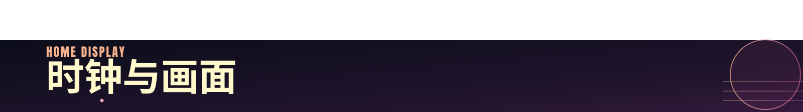
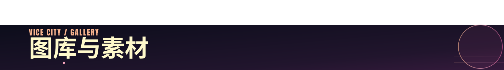
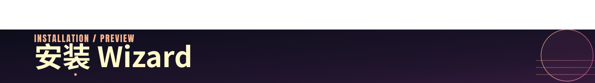
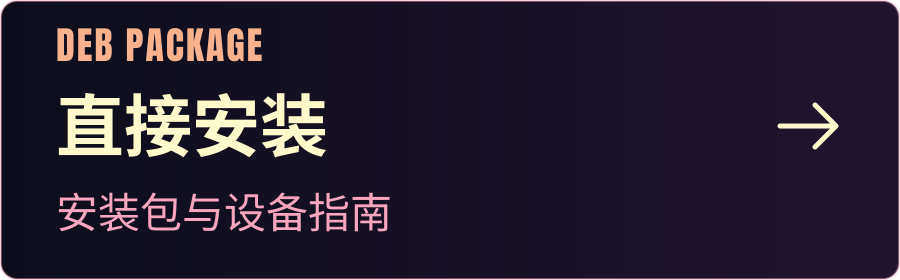
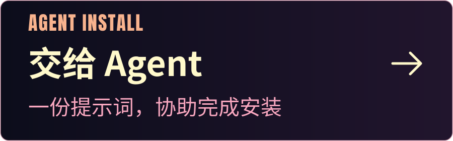
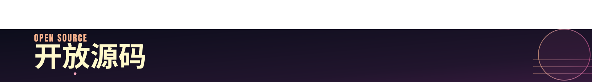

<p align="center">
<picture>
  <source media="(max-width: 767px) and (prefers-color-scheme: dark)" srcset="assets/readme/hero-mobile-dark.svg">
  <source media="(max-width: 767px)" srcset="assets/readme/hero-mobile.svg">
  <source media="(prefers-color-scheme: dark)" srcset="assets/readme/hero-dark.svg">
  
</picture>
</p>

<p align="center">翻页时钟、喜欢的壁纸与本地影像。<br>把旧 iPad，留给喜欢的画面。</p>

<p align="center">
  <a href="docs/INSTALL.md"><strong>安装指南</strong></a> &nbsp; · &nbsp;
  <a href="docs/AGENT-INSTALL.md">Agent 安装</a> &nbsp; · &nbsp;
  <a href="https://github.com/rexchen1803/wizard/releases">预览构建</a>
</p>

<p id="display" align="center">
<picture><source media="(max-width: 767px)" srcset="assets/readme/chapter-display-mobile.svg"></picture>
</p>

<p align="center"><a href="assets/demo/home-miami.jpg"></a></p>

<p align="center"><sub>iPad 模拟器 · iOS 18.0 · build 20261112.39 · <a href="assets/demo/README.md">截图来源</a></sub></p>

<p align="center">时钟、日期与日历，各就其位。<br>选择画面，调整位置，留下一块属于你的屏幕。</p>

<p align="center">
<a href="assets/demo/gallery-miami.jpg"></a>
&nbsp;
<a href="assets/demo/calendar-miami.jpg"></a>
</p>

<p align="center"><strong>壁纸图库</strong> &nbsp; · &nbsp; 分类、收藏、导入照片<br><strong>时钟与日历</strong> &nbsp; · &nbsp; 12/24 小时、秒显示、四种日期语言</p>

<details>
<summary>更多原生界面与功能</summary>

[内容分类](assets/demo/categories-miami.jpg) · [主菜单](assets/demo/menu-miami.jpg) · [设置](assets/demo/settings-miami.jpg) · [主题](assets/demo/themes-miami.jpg) · [时钟编辑](assets/demo/clock-edit-miami.jpg)

图库支持画面裁切、切换效果和独立壁纸布局。本地视频支持播放、暂停、进度、音量、最小化与返回。投屏、家庭状态、视频播放验收和设备范围见[兼容性说明](docs/COMPATIBILITY.md)。

</details>

<p id="materials" align="center">
<picture><source media="(max-width: 767px)" srcset="assets/readme/chapter-materials-mobile.svg"></picture>
</p>

<p align="center"></p>

<p align="center">从城市霓虹，到海岸与湿地。<br>挑选下一张壁纸，也可以导入自己的照片。</p>

<p align="center"><a href="https://github.com/rexchen1803/wizard/releases"><strong>获取图库与原始素材包</strong></a> &nbsp; · &nbsp; <a href="assets/media/MANIFEST.json">文件与校验值</a></p>

<details>
<summary>素材包内容与署名</summary>

- **App 图库包**：230 项目录，228 张图片、2 段兼容视频与缩略图。
- **原始素材包**：343 张原图、2 段 MKV 与 2 份 SRT。

文件名、下载地址与 SHA256 见[素材清单](assets/media/MANIFEST.json)。导入时保留原有的 `assets/user` 和设置，步骤见[安装指南](docs/INSTALL.md)。

GTA VI 素材版权归 Rockstar Games 及相关权利人，与 Wizard 的 MIT 源码许可分开。完整范围见[素材署名](assets/media/ATTRIBUTION.md)。

</details>

<p id="install" align="center">
<picture><source media="(max-width: 767px)" srcset="assets/readme/chapter-install-mobile.svg"></picture>
</p>

<p align="center">选择适合你的安装方式。</p>

<p align="center">
<a href="docs/INSTALL.md"></a>
&nbsp;
<a href="docs/AGENT-INSTALL.md"></a>
</p>

<p align="center">也可<a href="docs/open-source/README.md#build">从源码构建</a> · <a href="https://github.com/rexchen1803/wizard/releases">查看预览构建与安装包</a></p>

<p align="center"><sub>需要已准备好的 rootful 越狱环境。<br><a href="docs/COMPATIBILITY.md">设备与系统范围</a></sub></p>

<p id="source" align="center">
<picture><source media="(max-width: 767px)" srcset="assets/readme/chapter-source-mobile.svg"></picture>
</p>

<p align="center"><strong>Objective-C / UIKit · armv7 + arm64</strong></p>
<p align="center">为旧款 iPad 编写的原生展示应用。<br>阅读源码，改成你喜欢的样子。</p>

<p align="center"><a href="CONTRIBUTING.md">参与开发</a> &nbsp; · &nbsp; <a href="CHANGELOG.md">更新记录</a> &nbsp; · &nbsp; <a href="https://github.com/rexchen1803/wizard/issues/new/choose">报告问题</a></p>

<details>
<summary>构建命令与项目目录</summary>

在装有 Apple 开发工具的 Mac 上，自行准备 iPhoneOS SDK：

```sh
git clone https://github.com/rexchen1803/wizard.git
cd wizard
IOS_SDK="/path/to/iPhoneOS9.3.sdk" ./scripts/build-ipad.sh --out build
python3 tests/native-regressions.py
```

SDK 不随项目分发。当前验证 SDK 为 iPhoneOS 9.3；构建生成未签名的通用 App。[完整构建与回归命令](docs/open-source/README.md)。

- [App/](App/) — 原生 App、图标和可选电源插件源码。
- [scripts/](scripts/) — 构建、打包与仓库检查工具。
- [tests/](tests/) 与 [App/tests/](App/tests/) — 主机回归与打包检查。
- [docs/](docs/) — 安装、Agent 提示词、兼容性与技术说明。
- [assets/](assets/) — 展示图片、原生截图与素材清单。

</details>

<details>
<summary>版权与许可</summary>

Wizard 自有源码采用 [MIT License](LICENSE)。Google Material 图标路径采用 [Apache 2.0](licenses/Material-Icons-Apache-2.0.txt)。静态 Anton 展示字体采用 [SIL OFL 1.1](App/Resources/Anton-OFL.txt)，随 App 一起提供。完整署名见 [NOTICE](NOTICE) 与[第三方材料说明](THIRD_PARTY.md)。

GTA VI 图片、视频、缩略图与衍生素材版权归 **Rockstar Games 及相关权利人**，不适用 Wizard 的 MIT 许可。本项目与 Rockstar Games 无隶属或赞助关系。[安全问题](SECURITY.md)。

</details>

<p align="center"><sub>GTA VI 素材 © Rockstar Games 及相关权利人</sub></p>
<p align="center">Made by <a href="https://github.com/rexchen1803">Rex</a> &nbsp; · &nbsp; <a href="https://rexchen.si">rexchen.si</a></p>
