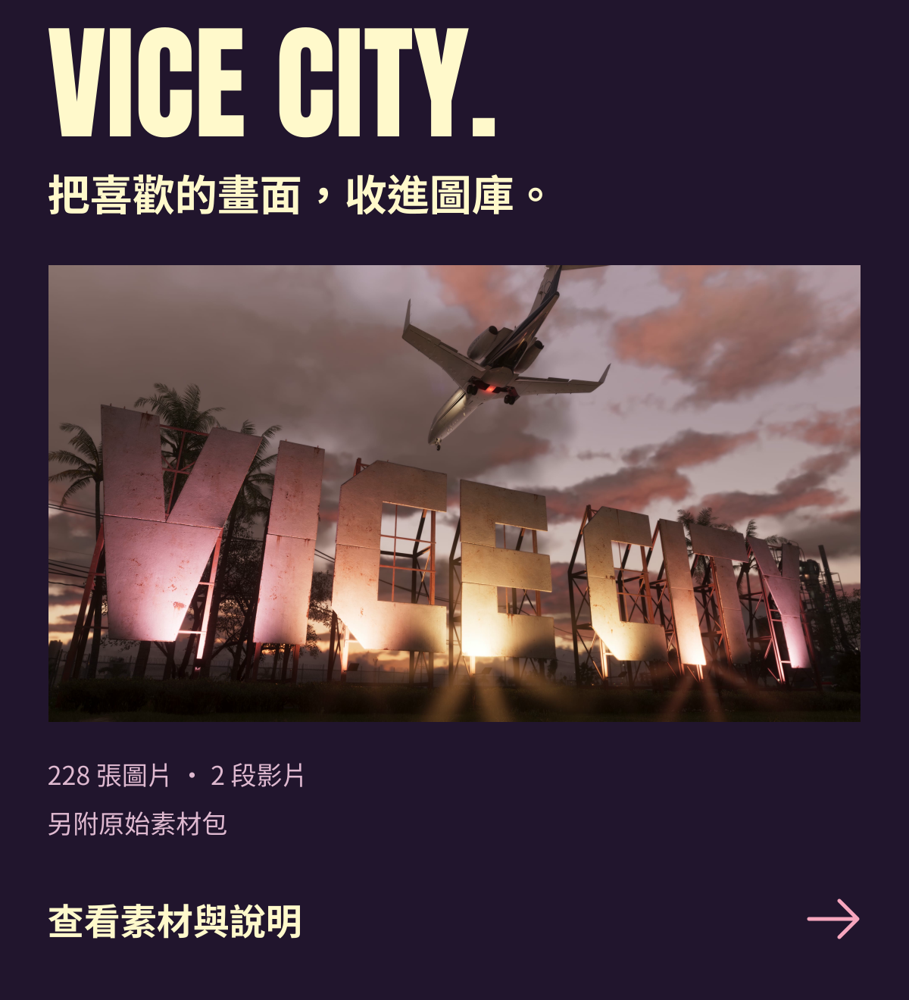
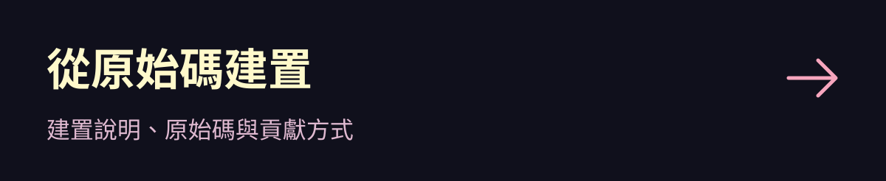
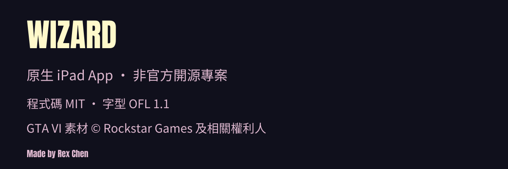

<a href="README.md">简体中文</a> · <strong>繁體中文</strong> · <a href="README.en.md">English</a> · <a href="README.ja.md">日本語</a>

<a href="docs/zh-TW/INSTALL.md"><picture><source media="(max-width: 767px)" srcset="assets/readme/hero-zh-tw-mobile.svg"></picture></a>
<picture><source media="(max-width: 767px)" srcset="assets/readme/showcase-zh-tw-mobile.svg"></picture>

<a href="docs/zh-TW/GTA6-MATERIALS.md"><picture><source media="(max-width: 767px)" srcset="assets/readme/collection-zh-tw-mobile.svg"></picture></a>
<a href="docs/zh-TW/INSTALL.md"><picture><source media="(max-width: 767px)" srcset="assets/readme/install-zh-tw-mobile.svg"></picture></a>
<a href="docs/zh-TW/AGENT-INSTALL.md"><picture><source media="(max-width: 767px)" srcset="assets/readme/agent-zh-tw-mobile.svg"></picture></a>
<a href="docs/zh-TW/DEVELOPMENT.md"><picture><source media="(max-width: 767px)" srcset="assets/readme/source-zh-tw-mobile.svg"></picture></a>
<a href="docs/zh-TW/THIRD_PARTY.md"><picture><source media="(max-width: 767px)" srcset="assets/readme/footer-zh-tw-mobile.svg"></picture></a>

